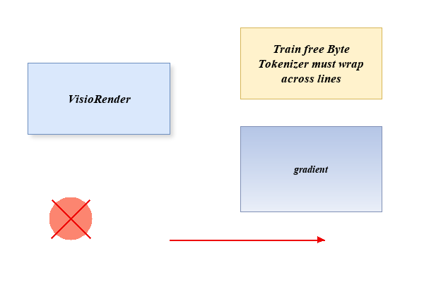

# VisioRender


**手头有个 `.vsdx`，机器上却没有 Visio？** 喂进来，吐一张 PNG。

> 给它一个 `.vsdx`，它把包里的 XML —— 几何、箭头、文字、渐变、阴影 —— 逐层解出来自己画成位图。
> 不调用 Visio，不联网，不需要 Office。



<p align="center"><em>仓库自带夹具 <code>tests/fixtures/demo.vsdx</code> 渲染出来的原样输出</em></p>

## 用起来长这样

```
$ python -m visiorender tests/fixtures/demo.vsdx -o docs/demo.png --dpi 100 --mode full
docs\demo.png  600x400 px  7 shapes  100 px/in  mode=full
```

一行从左到右是：输出路径、画布尺寸（宽×高）、这个包里画了多少个形状、密度（一英寸多少像素）；
末尾的 `mode=full` 只在用整页模式时出现。默认模式会把画布裁到图形的外接框，所以宽高比不一定等于纸张。

不想敲 `python -m`，装完就是：

```
$ visiorender 图.vsdx
图.png  3219x2407 px  108 shapes  200 px/in
```

## 装

**[⬇ 下载发行包](https://github.com/Offblink/VisioRender/releases/latest)** 里的 wheel：

```
pip install visiorender-0.1.0-py3-none-any.whl
```

或者从源码装：

```
pip install .              # 只用它
pip install -e ".[dev]"    # 还要跑测试和 lint
```

Python ≥ 3.10，依赖 `Pillow` 与 `numpy`，没有别的。

## 命令与选项

```
visiorender <src.vsdx> [-o OUT.png] [--dpi N] [--mode vector|full] [--media PNG]
            [--shadow-mode explicit|all|none] [--shadow-alpha A] [--shadow-blur INCHES]
            [--open | --register | --unregister]
```

| 选项 | 默认 | 干什么 |
|---|---|---|
| `-o, --out` | `<输入名>.png` | 输出路径，必须是 `.png` |
| `--dpi` | `200` | 一英寸多少像素（Visio 图是矢量的，多高都清晰） |
| `--mode` | `vector` | `vector` 裁到图形外接框；`full` 渲染整页纸 |
| `--media` | 无 | 页面里嵌图片时，用你给的 PNG 贴到那个位置（`full` 才用得上） |
| `--shadow-mode` | `explicit` | `explicit` 只画文件明确要求的阴影；`all` 所有实心图形都画；`none` 全不画 |
| `--shadow-alpha` | `0.16` | 阴影最深处的不透明度（0~1） |
| `--shadow-blur` | `0.030` | 阴影模糊半径，单位英寸 |
| `--open` / `--register` / `--unregister` | 关 | 打开结果图 / 接管 .vsdx 双击 / 还原，见下一节 |

退出码：`0` 成功；`1` 包读得了但渲染失败；`2` 参数或文件不对（缺文件、输出不是 `.png`）。

```
$ python -m visiorender nope.vsdx
error: no such file: nope.vsdx
$ echo $?
2

$ python -m visiorender tests/fixtures/demo.vsdx -o out.jpg
error: output must be a .png path: out.jpg
$ echo $?
2
```

## 当库用

```python
from visiorender import render

path, (w, h), shapes = render('架构.vsdx', '架构.png', dpi=200)
```

`render()` 的参数在 `src, out` 之后全部是关键字参数；返回 `(输出路径, (宽, 高), 形状数)`。

## 让它直接打开 .vsdx（Windows）

```
$ visiorender --register
  HKCU\Software\Classes\.vsdx
  HKCU\Software\Classes\VisioRender.vsdx
  HKCU\Software\Classes\VisioRender.vsdx\shell\open\command
  HKCU\Software\Microsoft\Windows\CurrentVersion\Explorer\FileExts\.vsdx\UserChoice (cleared)
  HKCU\Software\Microsoft\Windows\CurrentVersion\Explorer\FileExts\.vsdx\OpenWithProgids (cleared VisioViewer.Viewer)
  launcher: %LOCALAPPDATA%\VisioRender\open_vsdx.py
.vsdx now opens with VisioRender (VisioRender.vsdx); undo with --unregister
```

之后双击任何 `.vsdx`：渲染成同名 PNG，再用系统默认看图器打开它（渲染失败会写进
`%LOCALAPPDATA%\VisioRender\open.log`，不会无声无息）。两行要点：

- 写的是 **HKCU（当前用户）**，不需要管理员，也不碰别的扩展名。
- 「清除」那两行是 Windows 的坑：它另有一套优先于 `Software\Classes` 的
  解析（带哈希的 `UserChoice`、以及 `OpenWithProgids` 里的旧程序），不清掉就还是
  原来的程序接手。`--unregister` 会把被挪开的旧程序**放回去**，`.vsdx` 恢复成注册前的行为。

只想手动跑一次、不开双击：

```
$ visiorender --open 图.vsdx
图.png  3219x2407 px  108 shapes  200 px/in
opened 图.png
```

**（macOS / Linux 上 `--register` 不可用**，但 `--open` 照样会用系统默认程序打开结果图。）

## 它画对了什么

对着一张真实 Visio 导出的 PNG 做过对齐比对（标定到页坐标后逐像素算）：几何、连线、箭头端点、
换行位置、渐变色板都能对上；对齐后的平均色差 **1.8%**（255 满分 4.71）。这中间修掉的坑——
圆弧被画成透镜、箭头画反了端、换行漏数空格——记录在 `NOTES.md`。

## 它做不到的

- **图案填充不画**：`FillPattern` 只认「无」和「实心/渐变」，2、6 这类斜线网点叠加按实心处理。
- **线渐变不画**：`LineGradient`（描边渐变）忽略，按单色描边。
- **纯主题色的填充画不出来**：填充只写了 `Themed`、没有字面色值的图形保持透明（实测的手画图
  里没有这种）。
- **嵌入的图片要你先转好**：`--mode full` 时用 `--media` 给一张 PNG，Visio 自带的 EMF 它不解码。
- **阴影是拟合近似**：主题效果链（`ShapeShdwType` + 两组互相矛盾的 offset 值）没完全还原，
  规则与调参过程见 `NOTES.md`。渐变方向按 `FillGradientAngle` 线性处理，非线性类型（矩形/射线）
  同样近似。

## 想改它

- 逆向出来的 Visio 语义、调参账本、验证方法：`NOTES.md`
- 自检与回归：`python -m pytest`（19 项）+ `ruff check .`
- 夹具 `tests/fixtures/demo.vsdx` 由 `tests/make_fixture.py` **从零生成**，不夹带任何第三方母版

## 许可

MIT —— 见 `LICENSE`。
